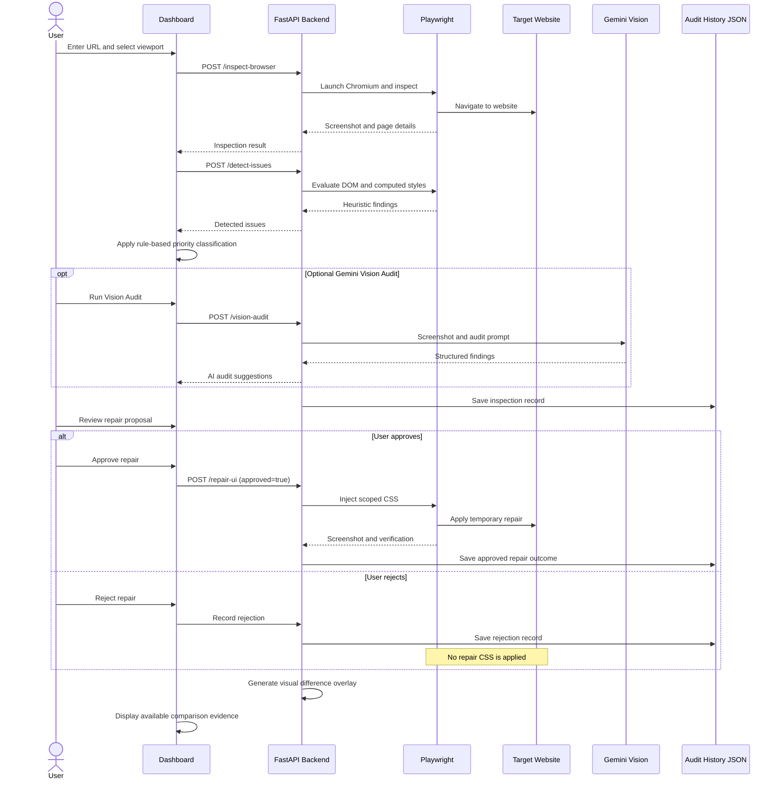

# OmniSight: Multimodal UI Self-Healing & RPA Agent

## Final Internship Project Report

---

# 1. Title Page

**Project Title:** OmniSight: Multimodal UI Self-Healing & RPA Agent

**Domain:** Artificial Intelligence, Robotic Process Automation (RPA), and Automated Web Quality Engineering

**Student Name:** Sheefa J Pathan

**Degree:** Bachelor of Engineering (B.E.) in Artificial Intelligence and Data Science

**Institution:** DR. D Y PATIL TECHNICAL CAMPUS

**Review Type:** Final Internship Project Submission

**Project Repository:** https://github.com/Sheefa04/OmniSight.git

---

# 2. Abstract

OmniSight is an interactive, human-in-the-loop UI self-healing and robotic process automation prototype. It combines a FastAPI backend with Playwright browser automation to inspect target websites across desktop, tablet, and mobile viewports.

The system uses deterministic DOM and computed-style heuristics to identify supported visual layout issues, capture screenshot evidence, and present detected problems through an interactive dashboard. It also provides an optional Gemini Vision-based screenshot audit to analyse visible UI issues and generate improvement suggestions.

OmniSight incorporates rule-based issue prioritization, persistent audit history, and an explicit human approval and rejection workflow. After approval (`approved=true`), the system applies scoped CSS remediation within the active Playwright browser session and performs four post-repair layout and overflow checks. Before-and-after screenshots and a visual difference overlay help demonstrate the repair outcome.

The system is designed to support safer and more transparent UI quality inspection without modifying the original target website source files. Permanent source-code modification, Git patch generation, and comprehensive downloadable audit report generation remain future enhancements.

---

# 3. Introduction

User interfaces (UIs) represent the primary interaction point between web platforms and their users. With the increasing variety of device form factors, maintaining consistent layouts across desktop, tablet, and mobile viewports has become an important challenge. A layout that works correctly on a desktop screen may cause horizontal overflow, clipped elements, overlapping components, or unreadable text on smaller mobile displays.

OmniSight addresses this challenge through browser automation, responsive layout inspection, and controlled remediation. It uses Playwright to inspect websites, collect visual evidence, and evaluate supported layout conditions using DOM geometry and computed CSS properties.

The platform also provides optional screenshot-based AI auditing, rule-based issue prioritization, and an audit history of inspection and repair activities. A human approval gate ensures that a repair is not executed without explicit authorization.

By combining automated inspection, transparent decision-making, session-scoped remediation, and post-repair verification, OmniSight demonstrates a controlled approach to automated web quality engineering.

---

# 4. Problem Statement

Web applications may contain visual and responsive layout defects that are not always detected by conventional functional testing. The key problems addressed by OmniSight are:

1. **Undetected Visual Flaws:** Traditional automated test suites primarily verify functional behaviour and may overlook visual regressions, clipped buttons, overlapping elements, and viewport overflow.

2. **Slow Remediation Cycles:** Identifying and reproducing visual defects across different viewport sizes often requires repeated manual inspection.

3. **Lack of Human Oversight:** Fully autonomous agents that modify website source code directly can introduce unintended changes and regressions.

4. **Disjointed Evidence:** Developers need a unified way to review detected issues alongside before-and-after screenshot evidence.

5. **Lack of Issue Prioritization:** Detected visual problems may require different levels of attention, making a structured priority classification useful.

6. **Limited Activity Traceability:** Without an audit trail, reviewing previous inspections, approval decisions, and repair outcomes becomes difficult.

OmniSight addresses these problems through automated browser inspection, issue classification, human-controlled remediation, audit logging, and post-repair verification.

---

# 5. Objectives

The primary objectives of OmniSight are:

1. **Automated Multi-Viewport Inspection:** Inspect valid HTTP/HTTPS URLs across desktop (1366 × 768), tablet (768 × 1024), and mobile (375 × 812 and 390 × 844) viewports.

2. **DOM-Based Visual Anomaly Detection:** Use deterministic heuristics to identify supported layout problems such as viewport overflow, oversized buttons, and improperly wrapped components.

3. **Screenshot-Based AI Auditing:** Provide an optional Gemini Vision audit to analyse captured screenshots and generate structured visual issue suggestions.

4. **Smart Issue Prioritization:** Classify detected issues into Critical, High, Medium, and Low priority levels using rule-based criteria.

5. **Human-in-the-Loop Safe Repair:** Enforce an explicit approval gate before applying any repair.

6. **Non-Destructive Session Remediation:** Apply scoped CSS changes within an active Playwright browser session without modifying original website source files.

7. **Automated Post-Repair Verification:** Evaluate four supported layout and overflow conditions after a repair attempt.

8. **Audit History and Traceability:** Record inspection events, approval and rejection decisions, and repair outcomes for later review.

9. **Visual Evidence Generation:** Capture before-and-after screenshots and generate a visual difference overlay to demonstrate the outcome.

---

# 6. Scope

## 6.1 In Scope — Currently Implemented System

The current implementation of OmniSight includes:

- An asynchronous FastAPI server with REST endpoints for health checks, browser inspection, issue detection, UI repair, Gemini Vision auditing, and audit history.
- Playwright-driven Chromium automation for browser navigation, viewport configuration, and screenshot capture.
- A built-in ShopHub responsive demonstration store (`frontend/store.html`) containing an intentional responsive button layout issue.
- Deterministic DOM and computed-style heuristic analysis for supported visual layout problems.
- Optional Gemini Vision screenshot analysis for visual issue descriptions and improvement suggestions.
- Rule-based issue prioritization with Critical, High, Medium, and Low classifications.
- An interactive dashboard with backend connection status, viewport selection, inspection results, AI audit results, and visual evidence.
- An explicit human approval and rejection workflow before repair execution.
- Scoped CSS remediation within the active Playwright browser session.
- Automated post-repair verification using four layout and overflow checks.
- Persistent JSON-based audit history for inspection, approval, rejection, and repair events.
- Before-and-after screenshot comparison and a semi-transparent visual difference overlay.
- URL validation and controlled browser-session handling to avoid modifications to original target website source files.

## 6.2 Out of Scope — Future Enhancements

The following capabilities are not part of the current implementation:

- Permanent modification of original website source code.
- Automated Git patch generation and GitHub Pull Request creation.
- Native mobile device testing beyond responsive browser emulation.
- Comprehensive downloadable PDF/HTML audit report generation.
- Expanded cross-browser testing.
- Advanced semantic verification and broader repair support.

---

# 7. Existing Systems and Limitations

Existing web testing and visual quality tools provide different approaches to identifying interface defects. OmniSight focuses on combining browser-based inspection with controlled, human-approved remediation.

| Feature | Traditional Unit/E2E Testing (Selenium/Cypress) | Commercial Visual Regression (Percy/Applitools) | OmniSight (Current Implementation) |
|---|---|---|---|
| Detection Basis | Functional assertions and DOM checks | Visual comparison against baselines | DOM and computed-style heuristics |
| Setup Overhead | Requires test scripts and configuration | Requires baseline configuration and maintenance | Provides a dashboard-driven supported workflow |
| Visual Evidence | Test results and logs | Screenshots and visual differences | Before/After screenshots and difference overlay |
| Self-Healing | Generally requires separate implementation | Primarily identifies visual differences | Applies scoped CSS repair after explicit human approval |
| Safety Control | Depends on test implementation | Depends on tool configuration | Explicit approval/rejection gate |
| Issue Prioritization | Depends on test implementation | Depends on tool configuration | Rule-based Critical, High, Medium, and Low classification |
| Audit History | Depends on test infrastructure | Depends on platform capabilities | JSON-based inspection and repair activity history |

OmniSight is a prototype focused on supported responsive layout issues and controlled browser-session remediation. It is not intended to replace comprehensive commercial visual regression platforms or general-purpose web testing frameworks.

---

# 8. Proposed System

OmniSight implements a five-stage human-in-the-loop quality engineering workflow.

1. **Target Ingestion:** The user enters a target website URL and selects the evaluation viewport.

2. **Automated Inspection:** FastAPI and Playwright launch Chromium, navigate to the target website, capture screenshots, and collect page information.

3. **Issue Analysis and Prioritization:** The heuristic engine identifies supported layout issues, and the dashboard assigns rule-based priority levels. The user may also run a separate Gemini Vision screenshot audit.

4. **Human Review and Audit Logging:** The user reviews the proposed repair and explicitly approves or rejects it. The decision is recorded in the audit history. Rejected repairs are not applied.

5. **Controlled Remediation and Verification:** Following approval, OmniSight attempts a scoped CSS repair on supported demo buttons within the active browser session. It captures the resulting screenshot, performs post-repair checks, and displays the before-and-after comparison and visual difference overlay.

The original target website source files are not modified by the session-scoped repair operation.

---

# 9. Requirements Specification

## 9.1 Hardware Requirements

- **Processor:** Intel Core i5 / AMD Ryzen 5 or higher.
- **RAM:** Minimum 8 GB; 16 GB recommended for concurrent Chromium instances.
- **Storage:** Minimum 2 GB of free disk space.

## 9.2 Software Requirements

- **Operating System:** Windows 10/11, macOS, or Linux.
- **Runtime Environment:** Python 3.12.10. Windows Proactor event loop configuration is used for asynchronous subprocess handling in the Windows environment.
- **Browser Automation:** Playwright 1.64.0 with the Chromium browser engine.
- **Web Technologies:** HTML5, CSS3, and JavaScript (ES6+).
- **Backend Framework:** FastAPI 0.149.0, Uvicorn 0.54.0, and Pydantic 2.14.1.
- **Image Processing:** Pillow (PIL) for screenshot comparison and visual difference generation.
- **AI Service:** Google GenAI SDK with Gemini Vision. API configuration and network access are required for the external AI audit feature.

---

# 10. Architecture and Workflow

OmniSight follows a human-in-the-loop architecture combining browser automation, deterministic UI inspection, optional screenshot-based AI analysis, rule-based issue prioritization, controlled CSS remediation, audit logging, and post-repair verification.

## 10.1 System Workflow

1. The user enters a website URL and selects a viewport.
2. FastAPI validates the request, and Playwright launches a Chromium browser.
3. The target website is inspected, and a screenshot is captured.
4. The heuristic detection engine evaluates DOM geometry and computed styles to identify supported layout issues.
5. The dashboard classifies detected issues using rule-based priority criteria.
6. The user may run Gemini Vision Audit on the captured screenshot to receive additional visual issue suggestions.
7. The inspection activity and findings are recorded in the audit history.
8. The user reviews the proposed repair and explicitly approves or rejects the operation.
9. A rejection is recorded without applying CSS. An approved request is sent to the repair endpoint with `approved=true`.
10. The backend attempts a scoped CSS repair within the active browser session and captures the resulting screenshot.
11. Four post-repair checks evaluate the target button and page layout.
12. The repair outcome and approval decision are recorded in the audit history.
13. OmniSight generates a visual difference overlay and displays the available comparison evidence on the dashboard.

## 10.2 Architecture Sequence

## 10.3 Post-Repair Verification

After an approved repair attempt, OmniSight performs four supported checks:

1. **Button Within Parent:** Evaluates whether the target button remains within its parent container.
2. **Button Text Fits:** Checks whether the button text fits within the target button layout.
3. **Text Wrapping Enabled:** Evaluates whether text wrapping is enabled.
4. **Page Horizontal Overflow:** Checks whether the page has horizontal overflow.

The verification result is reported using applicable statuses such as `resolved`, `partially_resolved`, `not_resolved`, or `not_applicable`.

These checks cover the supported conditions and do not represent a universal guarantee that every visual defect has been eliminated.

---

# 11. Technology Stack Details

- **Python 3.12:** Core programming language used for backend services and browser automation.
- **FastAPI:** Provides asynchronous REST API endpoints, request handling, and API documentation.
- **Playwright (Python Async):** Automates Chromium browser inspection, viewport configuration, JavaScript evaluation, and screenshot capture.
- **Pydantic:** Provides request validation and structured data models.
- **Google GenAI SDK — Gemini Vision:** Performs optional screenshot-based visual auditing and generates structured UI issue suggestions.
- **Pillow (PIL):** Processes screenshots and generates visual difference overlays.
- **HTML, CSS, and JavaScript:** Used to build the interactive OmniSight dashboard.
- **JSON:** Stores persistent audit history records for inspection and repair activities.
- **Pytest:** Supports automated testing of API endpoints, browser workflows, responsive layouts, safety controls, and audit history.
- **Git and GitHub:** Used for source-code version control and project repository management.

---

# 12. Implementation Details

## 12.1 Backend Implementation (`backend/main.py`)

### Inspection Service

The inspection service:

- Validates the target URL.
- Uses Playwright and Chromium to navigate to the website.
- Captures uniquely named screenshots using UUID4.
- Serves screenshot evidence through the `/screenshots/` static route.

### Heuristic Issue Detection

The detector evaluates visible page elements and computed styles to identify supported layout problems, including:

- Elements extending beyond viewport boundaries.
- Oversized or improperly wrapped demo buttons.
- Horizontal document overflow.

The detection mechanism is deterministic and based on supported DOM and computed-style conditions.

### Gemini Vision Audit

The `/vision-audit` endpoint accepts a screenshot filename and sends the image with a structured auditing prompt to the configured Gemini model.

The model returns structured JSON containing:

- Audit summary.
- Issue title and visible location.
- Description of the visible defect.
- Severity level.
- Suggested CSS or layout improvement.

The backend validates the response structure before returning it to the dashboard.

Gemini Vision is used for analysis and suggestions only; it does not directly execute or apply repairs. This feature requires a configured API key and network connectivity.

### Human-Approved Repair Service

The `/repair-ui` endpoint checks the approval field before applying a repair.

When approval is granted, the backend injects scoped CSS into the active Playwright browser page. The repair is temporary and limited to the active browser session. It does not modify the original website's source files.

### Post-Repair Verification

After an approved repair attempt, OmniSight performs four automated checks:

1. `button_within_parent` — Checks whether the target button remains within its parent boundaries.
2. `button_text_fits` — Checks whether the button content fits within the available button width.
3. `text_wrapping_enabled` — Checks whether text wrapping is enabled for the target button.
4. `page_horizontal_overflow` — Checks whether the document has horizontal overflow.

Based on the verification results, the system classifies the outcome as `resolved`, `partially_resolved`, `not_resolved`, or `not_applicable`.

These checks evaluate the supported layout conditions and do not represent comprehensive semantic verification of every possible UI defect.

### Audit History

OmniSight maintains an audit history of important inspection and repair workflow events.

- The `GET /audit-history` endpoint retrieves recorded audit entries.
- The `POST /audit-history` endpoint records workflow events.
- Records are stored in `backend/data/audit_history.json`.
- The history includes inspection activity, approval or rejection decisions, and repair outcomes.
- The backend retains a maximum of 500 records.

Audit History provides traceability of user decisions and repair activity. Its persistent JSON storage is separate from the temporary CSS repair, which remains limited to the active browser session.

### Smart Issue Prioritization

The dashboard assigns rule-based priority levels to detected issues using issue characteristics and the selected viewport.

- **Critical:** Page-wide overflow and horizontal overflow on supported mobile viewports.
- **High:** Oversized button issues and other supported non-mobile overflow cases.
- **Medium:** Positioning-related issues.
- **Low:** Issues that fall into the fallback classification.

The frontend uses `classifyIssuePriority(issue, viewport)` and `prioritizeIssues(issues, viewport)` to classify and order detected issues.

This is a rule-based prioritization mechanism, not an AI-generated severity classification.

### Backend API Endpoint Reference

The following REST API routes are implemented in `backend/main.py`.

| HTTP Method | Endpoint | Purpose |
|---|---|---|
| GET | `/` | Root endpoint |
| GET | `/dashboard` | Serves the OmniSight dashboard |
| GET | `/health` | Checks backend health |
| GET | `/viewports` | Provides supported viewport information |
| GET | `/audit-history` | Retrieves recorded audit entries |
| POST | `/audit-history` | Records workflow events |
| POST | `/inspect` | Performs website inspection |
| POST | `/inspect-browser` | Inspects a target website using browser automation |
| POST | `/capture-baseline` | Captures baseline evidence |
| GET | `/test-browser` | Provides browser test functionality |
| POST | `/detect-issues` | Detects supported UI layout issues |
| POST | `/vision-audit` | Performs optional Gemini Vision screenshot analysis |
| POST | `/sandbox-evaluate` | Evaluates the supported sandbox workflow |
| POST | `/repair-ui` | Applies a repair after explicit approval |
| POST | `/compare-screenshots` | Generates screenshot comparison results |

The endpoint list describes the routes implemented in the backend. Their individual availability and behaviour depend on the request parameters and application workflow.

## 12.2 Frontend Implementation (`frontend/dashboard.html`)

The dashboard provides:

- Website URL input and viewport selection.
- Browser inspection and issue detection controls.
- Gemini Vision Audit interface and display of AI-generated issue descriptions and suggestions.
- Rule-based issue priority labels: Critical, High, Medium, and Low.
- A Human-in-the-Loop review panel with explicit Approve and Reject actions before repair.
- Individual post-repair PASS/FAIL results for the supported verification checks.
- Before-and-after screenshot comparison and visual difference overlay display.
- Audit History access for reviewing recorded inspection, approval/rejection, and repair events.
- Dynamic status messages and error handling.

The `formatApiError()` utility converts backend errors into readable messages. Timestamp-based cache-busting ensures updated screenshots are loaded after new inspection or repair operations.

---

# 13. Testing and Results

The automated test suite was executed using Python 3.12.10 and pytest. The latest verified complete test run was recorded on 5 November 2026.

## 13.1 Latest Verified Test Result

| Metric | Result |
|---|---:|
| Total tests passed | 74 |
| Tests failed | 0 |
| Warnings | 6 |
| Execution time | 60.58 seconds |
| Overall result | PASS |

The six warnings were associated with a deprecated Pillow image-processing method. They did not cause test failures.

## 13.2 Test Coverage

The automated tests cover the following areas:

- ShopHub demonstration store behaviour.
- Responsive layout and viewport-related checks.
- API health and workflow behaviour.
- Approval and repair safety controls.
- Invalid URL and non-broken page handling.
- Screenshot comparison and visual difference generation.
- Audit history functionality.

The test results demonstrate successful execution of the tested application workflows. They do not establish that every possible website, browser configuration, or UI defect has been validated.

---

# 14. Screenshots and Evidence

The following screenshots document the dashboard, responsive inspection, issue detection, and repair workflow. The evidence is stored in `screenshots/evidence/`.

1. `01_dashboard_initial.png` — Initial OmniSight dashboard.
2. `02_desktop_store_1366x768.png` — ShopHub baseline at desktop resolution.
3. `03_mobile_store_375x812.png` — ShopHub inspection at mobile resolution.
4. `03b_mobile_store_390x844.png` — Additional mobile viewport inspection.
5. `04_tablet_store_768x1024.png` — ShopHub inspection at tablet resolution.
6. `05_dashboard_issues_detected.png` — Dashboard displaying detected layout issues.
7. `06_dashboard_repaired_comparison.png` — Dashboard showing the repair comparison workflow.

These images provide visual evidence of the tested application workflow. They should not be interpreted as proof that every possible defect has been resolved.

---

# 15. Limitations

1. **Non-Persistent Remediation:** CSS repairs are applied temporarily within the active Playwright browser session. The original website source files are not modified.

2. **Audit History Storage:** Workflow audit records are stored persistently in `backend/data/audit_history.json`. This record storage is separate from CSS remediation, which remains limited to the active browser session.

3. **Heuristic Detection Scope:** Deterministic detection focuses on supported geometric and computed-style conditions. It does not cover every possible layout or accessibility defect.

4. **AI Audit Limitations:** Gemini Vision analyses visible screenshot evidence. Its findings depend on the supplied image and model response and are not a guarantee of exhaustive visual or usability analysis.

5. **API Dependency:** Gemini Vision functionality requires a configured API key and network connectivity. If the key is unavailable, the audit endpoint returns an error rather than generating fabricated results.

6. **Repair Scope:** The current repair implementation targets supported demo button defects and is not a universal CSS repair solution.

7. **Network Connectivity:** Inspection of external websites requires suitable outbound HTTP/HTTPS connectivity.

---

# 16. Future Scope

The following enhancements can extend the capabilities of OmniSight:

1. **Git Patch and Pull Request Export:** Generate downloadable CSS patch files and optionally integrate with GitHub to create pull requests.

2. **Comprehensive Audit Reports:** Provide PDF and HTML reports containing screenshots, issue descriptions, severity levels, repair details, and verification results.

3. **Expanded Browser and Device Testing:** Extend testing to additional browsers, devices, and viewport configurations.

4. **Advanced Semantic Verification:** Introduce additional checks that complement the current geometry-based verification.

5. **Expanded Repair Capabilities:** Support a wider range of UI defects while preserving the human approval requirement.

---

# 17. Conclusion

OmniSight demonstrates a human-in-the-loop approach to automated website UI inspection and controlled self-healing. By combining FastAPI, Playwright, deterministic issue detection, and optional Gemini Vision screenshot analysis, the system provides a structured workflow for identifying and understanding visible UI defects.

The application includes rule-based Smart Issue Prioritization to classify detected issues as Critical, High, Medium, or Low. Its Human-in-the-Loop review panel requires an explicit approval or rejection decision before remediation. Audit History records important inspection activities, user decisions, and repair outcomes to improve workflow traceability.

The system supports user-approved CSS remediation, automated post-repair verification through four layout and overflow checks, and before-and-after visual comparison using a difference overlay. CSS repairs remain temporary within the active Playwright browser session, and the original website source files are not modified.

The latest verified automated test run completed with 74 tests passed, 0 tests failed, and 6 warnings. Overall, OmniSight demonstrates the practical integration of browser automation, visual AI analysis, rule-based prioritization, audit logging, controlled remediation, and post-repair verification while retaining human oversight.

---

# 18. References

1. **FastAPI Documentation:** FastAPI — Modern, High-Performance Web Framework for Python.  
   https://fastapi.tiangolo.com/

2. **Playwright for Python:** Microsoft — Playwright Library Documentation.  
   https://playwright.dev/python/

3. **Pydantic Documentation:** Pydantic — Data Validation Using Python Type Annotations.  
   https://docs.pydantic.dev/

4. **Google Gemini API Documentation:** Google AI for Developers — Gemini API.  
   https://ai.google.dev/gemini-api/docs

5. **Pillow Documentation:** Python Imaging Library — Pillow Documentation.  
   https://pillow.readthedocs.io/

6. **W3C CSS Flexible Box Layout Module:** World Wide Web Consortium.  
   https://www.w3.org/TR/css-flexbox-1/

7. **Responsive Web Design:** MDN Web Docs — Responsive Design Concepts.  
   https://developer.mozilla.org/en-US/docs/Learn_web_development/Core/CSS_layout/Responsive_Design

---

**End of Report**