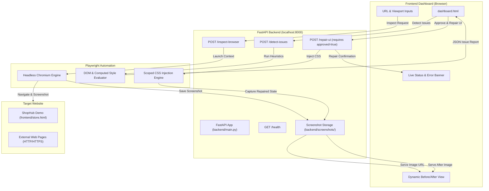

# OmniSight: Multimodal UI Self-Healing & RPA Agent

> **Autonomous Website UI Inspection, Heuristic Issue Detection, and Human-Approved Browser Self-Healing Prototype**

---

## 1. Project Overview

**OmniSight** is an automated web quality assurance and UI self-healing demonstration platform. It bridges the gap between layout defect discovery and immediate remediation by combining headless browser automation with interactive human oversight.

Unlike traditional testing suites that merely log failures in reports, OmniSight enables automated visual inspection across responsive viewports, analyzes DOM and computed style heuristics to detect visual flaws (such as oversized or unwrapped buttons and horizontal overflow), and applies non-destructive, temporary CSS repairs inside a real browser session—with dynamic before-and-after visual evidence.

---

## 2. Problem Statement

Modern responsive websites frequently suffer from visual regressions, overflow defects, broken styling, and viewport-specific rendering anomalies:
- **Delayed Remediation**: Visual defects often remain live until users file bug tickets or QA teams manually inspect each breakpoint.
- **Unwrapped & Overflowing Components**: On mobile viewports, components with fixed widths or rigid white-space rules overflow cards and disrupt usability.
- **Lack of Immediate Proof**: Developers and stakeholders require tangible visual comparisons (Before vs. After) before approving code changes.
- **Safety Concerns**: Autonomous repair agents must never alter production codebase files without human approval and visual validation.

OmniSight solves this with an approved-repair loop: **Inspect -> Detect -> Review -> Approve & Repair -> Compare**.

---

## 3. Key Objectives

1. **Automated Inspection**: Open any HTTP/HTTPS website using headless Chromium and capture timestamped full-page screenshots.
2. **Deterministic UI Issue Detection**: Use DOM evaluation and computed CSS styles to detect layout defects (such as button overflow and horizontal document spill).
3. **Human-in-the-Loop Safety**: Enforce an explicit approval gate (`approved=true`) before any repair action is dispatched.
4. **Temporary Session-Level Repair**: Inject safe, scoped CSS repairs within an active Playwright browser session without modifying the target site's source files.
5. **Dynamic Visual Comparison**: Provide side-by-side Before/After screenshot evidence with real-time feedback.

---

## 4. Current Implementation vs. Planned Scope

| Feature | Current Status | Description |
| :--- | :---: | :--- |
| **FastAPI Backend Service** | Implemented | Asynchronous REST API running on Python 3.12 & Uvicorn. |
| **Playwright Automation** | Implemented | Headless Chromium controller for website navigation and screenshots. |
| **DOM Issue Detection** | Implemented | Detects oversized buttons, horizontal viewport overflow, and buggy elements. |
| **ShopHub Demo Store** | Implemented | Local responsive e-commerce demo (`frontend/store.html`) with intentional layout defects. |
| **Approved Repair Flow** | Implemented | `/repair-ui` applies scoped CSS repair in Chromium when `approved=true`. |
| **Dynamic Before/After UI** | Implemented | Dashboard dynamically updates Before & After images with cache-busting timestamps. |
| **Multi-Viewport Testing** | Implemented | Desktop (1366x768), Tablet (768x1024), and Mobile (375x812 / 390x844). |
| **Multimodal Vision LLM** | Planned (Post Mid-Review) | Integration with Vision models for qualitative visual reasoning. |
| **Automated PR Generation** | Planned (Future) | Automatic Git commit and patch generator for source repositories. |

---

## 5. System Architecture

The following diagram represents the actual implemented architecture:



---

## 6. Technology Stack

- **Backend**: Python 3.12, FastAPI, Uvicorn, Pydantic v2
- **Browser Automation**: Playwright (Async Python API), Chromium
- **Frontend**: Semantic HTML5, Vanilla CSS3 (Custom Design System, Glassmorphic Panels), Vanilla JavaScript (ES6+, Fetch API)
- **Image Serving**: FastAPI StaticFiles directory mount (`/screenshots`)
- **Testing**: Playwright Sync API, Python HTTP test suites

---

## 7. Project Structure

```text
OmniSight/
├── backend/
│   ├── screenshots/              # Generated runtime inspection and repair screenshots
│   ├── main.py                   # Complete FastAPI application & Playwright endpoints
│   └── test-chromium.py          # Chromium launch smoke test
├── frontend/
│   ├── dashboard.html            # Main inspection, issue detection, and repair dashboard
│   └── store.html                # ShopHub demo store with intentional layout defects
├── screenshots/
│   └── evidence/                 # Verified evaluation & mid-review evidence screenshots
│       ├── 01_dashboard_initial.png
│       ├── 02_desktop_store_1366x768.png
│       ├── 03_mobile_store_375x812.png
│       ├── 03b_mobile_store_390x844.png
│       ├── 04_tablet_store_768x1024.png
│       ├── 05_dashboard_issues_detected.png
│       └── 06_dashboard_repaired_comparison.png
├── tests/
│   ├── test_demo_store.py        # Playwright assertions for demo store elements & viewports
│   └── test_omnisight_workflow.py# Complete end-to-end API, safety, and evidence test suite
├── docs/                         # Mid-review documentation, report, and presentation
├── .gitignore                    # Git ignore configurations (virtual envs, screenshots, caches)
└── README.md                     # Project documentation
```

---

## 8. Installation & Setup

### Prerequisites
- Python 3.10+ (Python 3.12 recommended)
- Google Chrome or Chromium installed via Playwright

### Step 1: Clone the Repository
```bash
git clone https://github.com/Sheefa04/OmniSight.git
cd OmniSight
```

### Step 2: Create and Activate Virtual Environment
```bash
# Windows (PowerShell)
python -m venv backend/.venv312
.\backend\.venv312\Scripts\Activate.ps1
```

### Step 3: Install Dependencies
```bash
pip install fastapi uvicorn playwright pydantic
playwright install chromium
```

---

## 9. Running the Application

### Start the FastAPI Backend
```bash
cd backend
python main.py
```
*The backend server will start at `http://127.0.0.1:8000`.*

### Access the Application
- **Interactive API Documentation (Swagger)**: `http://127.0.0.1:8000/docs`
- **OmniSight Dashboard**: `http://127.0.0.1:8000/frontend/dashboard.html`
- **ShopHub Demo Store**: `http://127.0.0.1:8000/frontend/store.html`

---

## 10. End-to-End Demo Procedure

1. Open `http://127.0.0.1:8000/frontend/dashboard.html` in your web browser.
2. Under **Demo website**, select **ShopHub**. The Website URL automatically populates with `http://127.0.0.1:8000/frontend/store.html`.
3. Choose your desired Viewport (e.g. **Mobile 375 × 812** or **Desktop 1366 × 768**).
4. Click **Start Inspection →**.
   - OmniSight launches Chromium, navigates to the target site, and captures a baseline screenshot.
   - The DOM issue detection engine detects the unwrapped `oversized-button`.
   - The **Before Repair** image loads in the comparison panel.
5. Review the issue details and click **Approve & Repair UI**.
   - OmniSight launches a Playwright session with the approved repair flag.
   - Scoped CSS (`max-width: 100% !important; white-space: normal !important;`) is injected to fix button text wrapping and dimensions.
   - The repaired screenshot is captured and rendered dynamically in the **After Repair** comparison panel.
   - The dashboard updates the **Repairs Applied** counter.

---

## 11. REST API Reference

| Endpoint | Method | Request Payload | Description |
| :--- | :---: | :--- | :--- |
| `/health` | `GET` | *None* | Verifies backend connectivity and system health. |
| `/inspect-browser` | `POST` | `{"url": "...", "viewport": "375x812"}` | Navigates to URL, captures full-page screenshot, and returns URL. |
| `/detect-issues` | `POST` | `{"url": "...", "viewport": "375x812"}` | Evaluates DOM and returns detected UI anomalies. |
| `/repair-ui` | `POST` | `{"url": "...", "approved": true}` | Injects safe temporary CSS fix and captures post-repair screenshot. |
| `/test-browser` | `GET` | *None* | Diagnostic endpoint to verify Chromium launches. |

---

## 12. Automated Testing & Verification

Run the comprehensive automated test suite:
```bash
.\backend\.venv312\Scripts\python.exe tests/test_omnisight_workflow.py
```

### Verified Test Cases:
1. `test_api_health`: Validates HTTP 200 and `"status": "healthy"`.
2. `test_safety_approved_false`: Confirms that unapproved repairs are strictly rejected with HTTP 400.
3. `test_safety_invalid_url`: Validates Pydantic HTTP URL rejection (HTTP 422).
4. `test_safety_non_broken_page`: Confirms truthful reporting (`not_applied`) when target page has no defects.
5. `test_responsive_viewports_and_workflow`:
   - Desktop (1366x768)
   - Mobile (375x812 & 390x844)
   - Tablet (768x1024)
   - Captures 7 high-resolution evidence screenshots to `screenshots/evidence/`.

---

## 13. System Limitations & Transparency

- **Session-Bound Repairs**: The CSS repairs are applied inside active Playwright browser sessions and recorded via screenshots. They do **not** modify or overwrite the original HTML/CSS files of the target website.
- **Rule-Based Heuristic Detection**: Current issue detection relies on deterministic DOM and computed-style measurements (bounding client rects, scrollWidth vs. innerWidth) rather than deep generative vision models.
- **Network Dependency**: Target websites must be reachable via standard HTTP/HTTPS protocols.

---

## 14. Future Scope (Post Mid-Review)

1. **Multimodal Vision-Language Model Integration**: Add vision models (e.g. Gemini Vision API) to identify semantic UI bugs (e.g., poor contrast, misaligned icons).
2. **Automated Source Patch Generator**: Expand the agent to propose verified CSS patches as downloadable `.diff` files or GitHub pull requests.
3. **Automated Post-Repair Retesting Agent**: Automatically re-run the heuristic detection engine against the repaired browser state to quantify improvement.
4. **Downloadable Audit Reports**: Export comprehensive PDF/HTML audit reports containing detected issues, repair logs, and before/after comparisons.

---

## 15. Author

- **Student**: Sheefa J Pathan
- **Branch**: BE Artificial Intelligence and Data Science
- **Project**: OmniSight — Multimodal UI Self-Healing & RPA Agent
