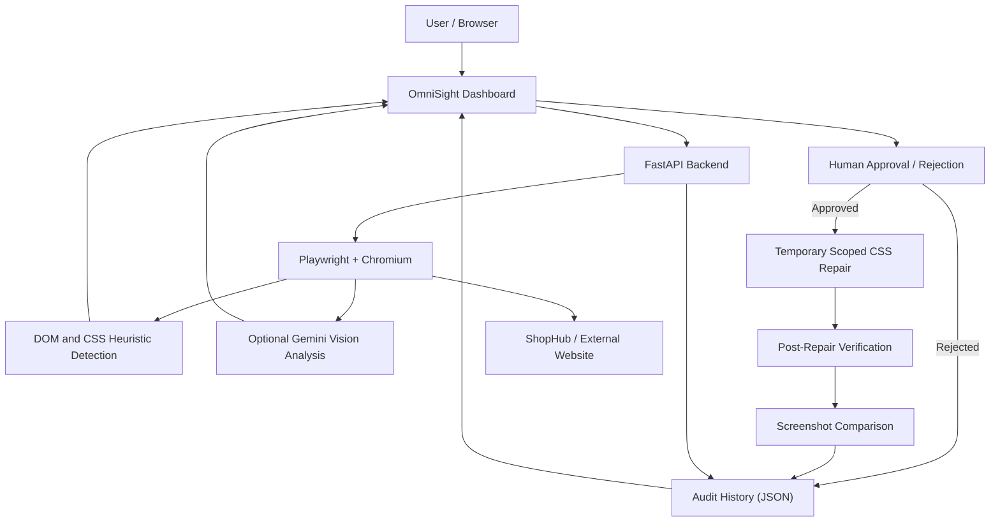

# OmniSight: Multimodal UI Self-Healing & RPA Agent

> **Automated Website UI Inspection, Rule-Based Issue Detection, Gemini Vision Analysis, and Human-Approved Browser Self-Healing Prototype**

---

## 1. Project Overview

**OmniSight** is a web quality assurance and UI self-healing prototype designed to identify responsive website layout defects, explain detected issues, and apply human-approved temporary repairs.

It combines FastAPI, Playwright browser automation, DOM and computed-style analysis, optional Gemini Vision screenshot analysis, and an interactive dashboard.

The system follows a controlled workflow:

**Website URL → Inspection → Issue Detection → Prioritization → Human Review → Approved Repair → Verification → Visual Comparison → Audit History**

OmniSight uses a local ShopHub demonstration store containing intentional responsive UI defects. It can also inspect reachable HTTP/HTTPS websites.

Repairs are injected into a Playwright browser session and do not permanently modify the target website's source files.

## 2. Problem Statement

Responsive websites can suffer from visual defects such as overflowing buttons, clipped text, overlapping elements, and horizontal scrolling.

Common challenges include:

- **Delayed defect detection:** Visual issues may remain unnoticed until manual QA or user reports.
- **Responsive layout failures:** Fixed widths and rigid CSS rules can break mobile and tablet layouts.
- **Limited visual evidence:** Developers need before-and-after evidence to understand whether a repair improved the interface.
- **Unsafe automatic modifications:** Repair systems should not modify website source files without explicit human authorization.
- **Insufficient traceability:** Inspection, approval, rejection, and repair outcomes should be recorded for review.

OmniSight addresses these challenges through browser-based inspection, issue analysis, controlled repair, post-repair verification, and an audit trail.

## 3. Key Objectives

1. Inspect reachable HTTP/HTTPS websites using Playwright and Chromium.
2. Capture screenshots across desktop, tablet, and mobile viewports.
3. Detect layout defects using DOM measurements and computed CSS properties.
4. Prioritize detected issues using a transparent rule-based classifier.
5. Provide optional Gemini Vision screenshot analysis.
6. Require explicit human approval before applying repairs.
7. Inject temporary, scoped CSS within a browser session.
8. Verify repaired UI conditions and compare before-and-after screenshots.
9. Maintain inspection, approval, rejection, and repair history.

## 4. Current Implementation Status

| Feature | Status | Description |
|---|---|---|
| FastAPI backend | Implemented | REST API using Python 3.12 |
| Playwright automation | Implemented | Chromium navigation and screenshot capture |
| DOM issue detection | Implemented | Layout and computed-style heuristics |
| ShopHub demo store | Implemented | Responsive store with intentional UI defects |
| Human approval workflow | Implemented | Explicit approve/reject review panel |
| Temporary CSS repair | Implemented | Session-scoped browser CSS injection |
| Smart issue prioritization | Implemented | Rule-based critical/high/medium/low classification |
| Gemini Vision integration | Implemented | Optional screenshot-based visual analysis |
| Post-repair verification | Implemented | Four browser-based verification checks |
| Screenshot comparison | Implemented | Before-and-after visual difference analysis |
| Repair history and audit trail | Implemented | Persistent JSON audit records |
| CSS candidate sandbox | Backend implemented | Isolated CSS evaluation endpoint; dashboard integration not verified |
| Automated Git patch/PR generation | Future scope | Not currently implemented |
| Runtime downloadable audit report | Future scope | Not currently verified as a dashboard feature |

## 5. System Architecture



### Main components

- **Frontend:** Dashboard for URL input, viewport selection, issue review, approval, repair, and evidence display.
- **Backend:** FastAPI endpoints for inspection, detection, repair, visual analysis, comparison, and audit history.
- **Browser automation:** Playwright and Chromium perform website navigation, screenshot capture, CSS injection, and verification.
- **Visual analysis:** Optional Gemini Vision integration analyzes screenshots independently of the rule-based DOM detector.
- **Audit storage:** JSON records preserve inspection and repair events.

## 6. Technology Stack

| Layer | Technologies |
|---|---|
| Programming language | Python 3.12 |
| Backend | FastAPI, Uvicorn |
| Data validation | Pydantic v2 |
| Browser automation | Playwright, Chromium |
| Frontend | HTML5, CSS3, Vanilla JavaScript |
| Visual AI | Google Gemini API through `google-genai` |
| Image processing | Pillow |
| Environment configuration | python-dotenv |
| Automated testing | pytest |
| Version control | Git and GitHub |

### Verified development environment

- Python: 3.12.10
- FastAPI: 0.149.0
- Uvicorn: 0.54.0
- Pydantic: 2.14.1
- Pillow: 13.0.0
- Playwright: Installed in the project environment

## 7. Project Structure

```text
OmniSight/
├── backend/
│   ├── main.py
│   ├── repair_sandbox.py
│   ├── test-chromium.py
│   ├── test_chromium.py
│   ├── test_screenshot.png
│   ├── screenshots/
│   └── data/                 # Runtime audit data; Git-ignored
│
├── frontend/
│   ├── dashboard.html
│   └── store.html
│
├── screenshots/
│   └── evidence/
│       ├── 01_dashboard_initial.png
│       ├── 02_desktop_store_1366x768.png
│       ├── 03_mobile_store_375x812.png
│       ├── 03b_mobile_store_390x844.png
│       ├── 04_tablet_store_768x1024.png
│       ├── 05_dashboard_issues_detected.png
│       └── 06_dashboard_repaired_comparison.png
│
├── tests/
│   ├── test_audit_history.py
│   ├── test_compare_screenshots.py
│   ├── test_demo_store.py
│   ├── test_omnisight_workflow.py
│   └── test_viewport_phase3.py
│
├── docs/
│   ├── DAY_1_BASELINE_AUDIT.md
│   ├── FINAL_IMPLEMENTATION_ROADMAP_2026.md
│   ├── FINAL_PROJECT_REPORT.md
│   ├── FINAL_PROJECT_REPORT.pdf
│   ├── FINAL_REVIEW_AUDIT.md
│   ├── GEMINI_VISION_AUDIT.md
│   ├── MID_REVIEW_PRESENTATION.md
│   ├── PROJECT_REPORT.md
│   ├── SAFETY_AND_APPROVAL.md
│   └── TEST_RESULTS.md
│
├── generate_final_report.py
├── generate_report_docx.py
├── README.md
└── .gitignore
```

## 8. Installation and Setup

### Prerequisites

- Python 3.12 recommended.
- Git.
- Internet connectivity for downloading packages and accessing external target websites.
- Chromium installed through Playwright.
- Optional Gemini API key for visual AI analysis.

### Step 1: Clone the repository

```powershell
git clone https://github.com/Sheefa04/OmniSight.git
cd OmniSight
```

### Step 2: Create and activate the virtual environment

```powershell
python -m venv backend/.venv312
.\backend\.venv312\Scripts\Activate.ps1
```

### Step 3: Install dependencies

```powershell
python -m pip install fastapi uvicorn pydantic playwright Pillow python-dotenv google-genai pytest
```

### Step 4: Install Chromium

```powershell
playwright install chromium
```

### Step 5: Configure Gemini Vision (Optional)

Create `backend/.env` and configure the Gemini API key:

```env
GEMINI_API_KEY=your_gemini_api_key
```

Keep the `.env` file private. It is excluded from Git tracking. Do not commit or publish API keys.

Without a configured API key, the Vision Audit endpoint cannot perform Gemini analysis and may return HTTP 503.

## 9. Running the Application

Run the following command from the **OmniSight project root**, not from inside the `backend` folder:

```powershell
python -m backend.main
```

The API server runs at:

`http://127.0.0.1:8000`

### Access the application

- **Dashboard:** http://127.0.0.1:8000/frontend/dashboard.html
- **ShopHub Demo Store:** http://127.0.0.1:8000/frontend/store.html
- **Swagger API Documentation:** http://127.0.0.1:8000/docs
- **Health Check:** http://127.0.0.1:8000/health

## 10. End-to-End Demonstration Workflow

1. Start the backend from the project root.
2. Open the OmniSight dashboard.
3. Select ShopHub or enter a reachable website URL.
4. Select a viewport, such as Desktop 1366 × 768 or Mobile 375 × 812.
5. Click **Start Inspection**.
6. Review the captured screenshot and detected issues.
7. Examine issue priority and repair suggestions.
8. Click **Review & Repair UI** to open the human review panel.
9. Explicitly choose **Approve** or **Reject**.
10. If rejected, no CSS repair is applied; the rejection is recorded in audit history.
11. If approved, the backend applies temporary scoped CSS in the Playwright session.
12. The system performs post-repair verification and captures the repaired screenshot.
13. Review the before-and-after comparison and repair result.
14. Inspect the recorded events in Repair History.

### Post-repair verification

The repair workflow checks:

- `button_within_parent`
- `button_text_fits`
- `text_wrapping_enabled`
- `page_horizontal_overflow`

The repair result can be reported as `resolved`, `partially_resolved`, or `not_resolved`.

## 11. REST API Reference

| Endpoint | Method | Description |
|---|---|---|
| `/` | GET | Root application response |
| `/dashboard` | GET | Dashboard route |
| `/health` | GET | Backend health status |
| `/viewports` | GET | Available viewport information |
| `/audit-history` | GET | Retrieve audit history |
| `/audit-history` | POST | Create an audit history record |
| `/inspect` | POST | Website inspection |
| `/inspect-browser` | POST | Browser-based inspection and screenshot capture |
| `/capture-baseline` | POST | Capture baseline screenshot |
| `/test-browser` | GET | Chromium launch diagnostic |
| `/detect-issues` | POST | DOM-based issue detection |
| `/vision-audit` | POST | Gemini Vision screenshot analysis |
| `/sandbox-evaluate` | POST | Evaluate a candidate CSS repair in an isolated browser context |
| `/repair-ui` | POST | Apply human-approved temporary CSS repair |
| `/compare-screenshots` | POST | Compare original and repaired screenshots |

### Important API safety behaviour

- `/repair-ui` requires `approved=true`.
- Requests without approval are rejected.
- URL and viewport inputs are validated.
- CSS candidate evaluation uses an isolated browser context.
- Repair CSS is temporary and does not permanently modify target website source files.

## 12. Automated Testing and Verification

Run the complete test suite from the project root using the Python 3.12 virtual environment:

```powershell
python -m pytest tests -q
```

### Latest verified test result — 10 November 2026

| Result | Count |
|---|---:|
| Tests passed | 74 |
| Tests failed | 0 |
| Warnings | 6 |
| Execution time | 51.34 seconds |

### Test coverage

The test suite includes:

- API health and endpoint behaviour.
- Approval and rejection safety.
- Invalid URL handling.
- ShopHub demo-store checks.
- Responsive viewport testing.
- Browser inspection and workflow verification.
- Audit history persistence and validation.
- Screenshot comparison and image handling.

### Warning transparency

The 10 November 2026 test run reported six non-blocking Pillow deprecation warnings associated with `Image.Image.getdata()` in `backend/main.py` at line 1113. These warnings did not cause test failures. Review this usage before upgrading to a Pillow release that removes the deprecated API.

## 13. System Limitations and Transparency

- **Session-bound repairs:** CSS changes are injected into a Playwright browser session and do not permanently modify target website files.
- **Rule-based DOM detection:** The primary issue prioritization and detection logic uses deterministic DOM and computed-style rules; it is not a generative AI detector.
- **Optional visual AI:** Gemini Vision is a separate screenshot-analysis capability. API key configuration and external service availability are required.
- **Historical AI verification:** A live Gemini Vision API test was recorded on 31 October 2026. Recent live API attempts on 10 November 2026 returned provider errors (HTTP 503/502); current Gemini service availability is therefore unconfirmed. The integration remains optional and must not be represented as a successful live analysis unless a fresh run succeeds.
- **Backend-only sandbox integration:** CSS candidate evaluation exists in the backend; integration with the dashboard has not been verified.
- **Repair scope:** The current repair workflow focuses on supported button layout and overflow conditions, not every possible visual defect.
- **Network dependency:** External target websites must be reachable through HTTP/HTTPS.

## 14. Future Scope

1. Generate downloadable CSS patch files and GitHub pull requests for developer review.
2. Integrate CSS candidate sandbox evaluation into the dashboard.
3. Develop iterative repair and verification using broader UI defect categories.
4. Expand semantic visual analysis and cross-browser testing.
5. Provide downloadable PDF/HTML audit reports containing inspection history, repair outcomes, and visual evidence.
6. Expand support for additional layout defects and responsive design patterns.

## 15. Author

- **Student:** Sheefa J Pathan
- **Branch:** B.E. Artificial Intelligence and Data Science
- **Institution:** DR. D Y PATIL TECHNICAL CAMPUS
- **Project:** OmniSight — Multimodal UI Self-Healing & RPA Agent
- **Project Type:** Individual Internship Project
