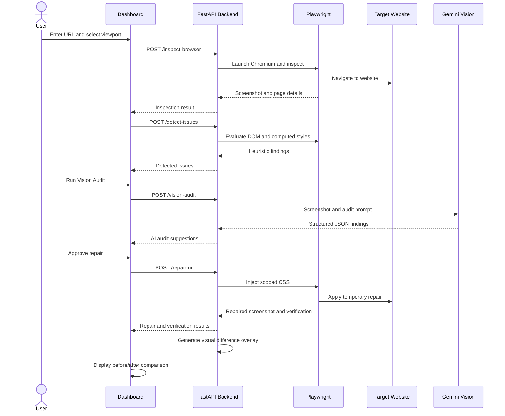

# OmniSight: Multimodal UI Self-Healing & RPA Agent
## Final Internship Project Report

---

### 1. Title Page

- **Project Title**: OmniSight: Multimodal UI Self-Healing & RPA Agent
- **Domain**: Artificial Intelligence, Robotic Process Automation (RPA), Automated Web Quality Engineering
- **Student**: Sheefa J Pathan
- **Degree**: Bachelor of Engineering (B.E.) in Artificial Intelligence and Data Science
- **Institution**: DR. D Y PATIL TECHNICAL CAMPUS
- **Review Type**: Final Internship Project Submission
- **Repository**: `https://github.com/Sheefa04/OmniSight.git`

---

### 2. Abstract
**OmniSight** introduces an interactive, human-in-the-loop UI self-healing architecture. By pairing a FastAPI backend with Playwright browser automation, OmniSight inspects target websites across desktop, tablet, and mobile breakpoints. It performs deterministic DOM and computed-style heuristic analysis to locate visual anomalies, captures visual evidence, and presents findings to the developer. Upon explicit user authorization (`approved=true`), OmniSight applies a scoped CSS repair within an isolated browser session, captures the repaired state, and displays Before/After visual comparisons.

The current implementation integrates deterministic UI issue detection, Gemini Vision screenshot analysis, human-approved CSS remediation, automated post-repair verification through four layout and overflow checks, and before-and-after visual comparison with a difference overlay. Git patch generation and comprehensive report export remain planned future enhancements.
---
### 3. Introduction

User interfaces (UIs) represent the primary touchpoint between web platforms and their end users. With the explosion of responsive device form factors—ranging from ultra-wide desktop monitors to compact mobile viewports—maintaining visual consistency has become an increasingly complex challenge. A styling rule designed for a 1366×768 resolution can easily cause horizontal overflow or unreadable text wrapping on a 375×812 mobile display.

OmniSight combines browser automation and responsive layout heuristics to create a reliable visual feedback loop. The tool provides developers and QA teams with immediate visual evidence of UI regressions alongside approved, session-isolated repairs that demonstrate how the layout should appear once corrected.

---

### 4. Problem Statement

1. **Undetected Visual Flaws**: Traditional automated test suites verify functional code execution but routinely overlook visual regressions, clipped buttons, and viewport overflow.
2. **Slow Remediation Cycles**: Discovering, verifying, and fixing a visual defect typically requires manual reproduction across multiple physical devices or browser dev tools.
3. **Lack of Human Oversight in Autonomous Agents**: Completely autonomous agents that modify source code directly introduce high risk of introducing regressions or unintended side effects into production repositories.
4. **Disjointed Evidence**: Developers lack unified dashboards that correlate reported layout metrics with side-by-side Before/After screenshot proof.

---

### 5. Objectives
1. **Automated Multi-Viewport Inspection**: Build an automation engine capable of inspecting any valid HTTP/HTTPS URL across custom breakpoints (Desktop 1366×768, Tablet 768×1024, Mobile 375×812 and 390×844).
2. **DOM-Based Visual Anomaly Detection**: Implement heuristic detection algorithms to flag components extending beyond viewport boundaries and elements with unconstrained padding or unwrapped text.
3. **Human-in-the-Loop Safe Repair**: Enforce a mandatory authorization gate ensuring repairs only execute with explicit human approval.
4. **Non-Destructive Session Remediation**: Apply CSS repairs inside an active browser session without altering original source files, preventing unintended repository mutations.
5. **Dynamic Evidence Generation**: Automatically generate and render timestamped Before/After screenshot evidence in a modern dashboard interface.

---
### 6. Scope

#### In Scope (Currently Implemented System):

- Asynchronous FastAPI server with RESTful endpoints (`/health`, `/inspect-browser`, `/detect-issues`, `/repair-ui`, `/vision-audit`).
- Playwright-driven Chromium automation for headless navigation and full-page screenshots.
- Built-in ShopHub responsive demonstration store (`frontend/store.html`) featuring an intentional responsive button flaw.
- Deterministic heuristic analysis for horizontal viewport overflow, oversized components, and supported layout defects.
- Gemini Vision screenshot-based analysis for identifying visible UI issues and suggesting improvements.
- Interactive Dashboard UI with real-time backend connection status, viewport selection, metrics tracking, AI audit results, and Before/After image comparison.
- Human-approved CSS remediation using the `approved=true` requirement.
- Automated post-repair verification using four layout and overflow checks.
- Screenshot difference analysis with a semi-transparent visual overlay.
- URL validation and controlled browser-session repair to prevent modification of original website source files.

#### Out of Scope (Future Scope):

- Permanent source code modification or automated GitHub Pull Request generation.
- Native mobile device testing beyond responsive browser emulation.
- Comprehensive PDF/HTML audit report generation and export.
- Expanded cross-browser testing and advanced semantic verification.

---

### 7. Existing Systems & Limitations

| Feature / Tool | Traditional Unit/E2E Testing (Selenium / Cypress) | Commercial Visual Regression (Percy / Applitools) | OmniSight (Current Implementation) |
| :--- | :--- | :--- | :--- |
| **Detection Basis** | Functional assertions (DOM presence) | Pixel-by-pixel diffing against baselines | DOM & computed style heuristics |
| **Setup Overhead** | High (requires writing explicit scripts) | High (requires maintaining baseline diffs) | Low for supported workflows; configuration and browser dependencies may be required. |
| **Self-Healing** | None (reports pass/fail only) | None (highlights pixel differences) | **Applies a scoped CSS repair after explicit human approval** |
| **Safety Control** | N/A | N/A | **Explicit human approval gate** |
| **Before/After Live Proof** | No | Diff masks only | **Side-by-side visual comparison** |

---

### 8. Proposed System

OmniSight implements a 5-stage closed-loop quality engineering workflow:

1. **Target Ingestion**: The user inputs a target URL and selects the evaluation viewport.
2. **Automated Capture**: Headless Chromium navigates to the URL, awaits network idle, and saves a high-resolution baseline screenshot.
3. **Heuristic Evaluation**: In-page scripts evaluate bounding client rectangles and computed styles to detect anomalies.
4. **Approval Gate**: The dashboard presents the detected defect and awaits explicit user authorization before triggering remediation.
5. **Session Remediation & Visual Diff**: After explicit approval, Playwright attempts a scoped CSS repair on supported demo buttons. If a matching button is found, it applies the temporary repair within the browser session and captures the resulting state. The dashboard presents the repair result and Before/After evidence. The original website source files are not modified.

---

### 9. Requirements Specification

#### 9.1 Hardware Requirements
- **Processor**: Intel Core i5 / AMD Ryzen 5 or higher.
- **RAM**: Minimum 8 GB (16 GB recommended for concurrent Chromium instances).
- **Storage**: Minimum 2 GB free disk space.

#### 9.2 Software Requirements
- **Operating System**: Windows 10/11, macOS, or Linux.
- **Runtime Environment**: Python 3.12.10 (Windows Proactor event loop configuration used for asynchronous subprocess handling).
- **Browser Automation**: Playwright 1.64.0 with Chromium browser engine.
- **Web Technologies**: HTML5, Vanilla CSS3, Modern JavaScript (ES6+).
- **Backend Framework**: FastAPI 0.149.0, Uvicorn 0.54.0, and Pydantic 2.14.1.

---
## 10. Architecture and Workflow

OmniSight follows a human-in-the-loop architecture combining browser automation, deterministic UI inspection, screenshot-based AI analysis, controlled CSS remediation, and post-repair verification.

### 10.1 System Workflow

1. The user enters a website URL and selects a viewport.
2. FastAPI validates the request and Playwright launches a Chromium browser.
3. The target website is inspected and a screenshot is captured.
4. The heuristic detection engine evaluates DOM geometry and computed styles to identify supported layout issues.
5. The user can run Gemini Vision Audit on the captured screenshot to identify visible UI defects and receive structured suggestions.
6. The user reviews the proposed repair and explicitly approves the repair operation.
7. The backend injects scoped CSS into the browser session and captures the repaired screenshot.
8. Four post-repair checks evaluate the target button and page layout.
9. OmniSight generates a visual difference overlay and displays the comparison results on the dashboard.

### 10.2 Architecture Sequence

## 11. Technology Stack Details

- **Python 3.12:** Core programming language used for backend services and automation.
- **FastAPI:** Provides asynchronous REST API endpoints, request handling, and API documentation.
- **Playwright (Python Async):** Automates Chromium browser inspection, viewport configuration, JavaScript evaluation, and screenshot capture.
- **Pydantic:** Provides request validation and structured data models.
- **Google GenAI SDK – Gemini Vision:** Performs screenshot-based visual auditing and generates structured UI issue suggestions.
- **Pillow (PIL):** Processes screenshots and generates visual difference overlays.
- **HTML, CSS and JavaScript:** Used to build the interactive OmniSight dashboard.
- **Pytest:** Supports automated testing of application workflows and API behaviour.
- **Windows Proactor Event Loop Policy:** Configured for Windows compatibility with asynchronous browser automation.

## 12. Implementation Details

### 12.1 Backend Implementation (`backend/main.py`)

**Inspection Service**

- Validates the target URL.
- Uses Playwright and Chromium to navigate to the website.
- Captures uniquely named screenshots using UUID4.
- Serves screenshot evidence through the `/screenshots/` static route.

**Heuristic Issue Detection**

The detector evaluates visible page elements and computed styles to identify supported layout problems, including:

- Elements extending beyond viewport boundaries.
- Oversized or unwrapped demo buttons.
- Horizontal document overflow.

**Gemini Vision Audit**

The `/vision-audit` endpoint accepts a screenshot filename and sends the image with a structured auditing prompt to the configured Gemini model.

The model returns JSON containing:

- Audit summary.
- Issue title and visible location.
- Description of the visible defect.
- Severity level.
- Suggested CSS or layout improvement.

The backend validates the response structure before returning it to the dashboard. Gemini Vision is used for analysis and suggestions only; it does not directly execute or apply repairs.

**Human-Approved Repair Service**

The `/repair-ui` endpoint checks the approval field before applying a repair. When approval is granted, the backend injects scoped CSS into the active browser page.

The repair is temporary and limited to the browser session. It does not modify the original website's source files.
**Post-Repair Verification**

After applying an approved repair, OmniSight performs four automated checks:

1. `button_within_parent` - Checks whether the target button remains within its parent boundaries.
2. `button_text_fits` - Checks whether the button content fits within the available button width.
3. `text_wrapping_enabled` - Checks whether text wrapping is enabled for the target button.
4. `page_horizontal_overflow` - Checks whether the document has horizontal overflow.

Based on the verification results, the system classifies the outcome as `resolved`, `partially_resolved`, `not_resolved`, or `not_applicable`. These checks evaluate the supported layout conditions and do not represent comprehensive semantic verification of every possible UI defect.

**Visual Difference Overlay**

Pillow processes the original and repaired screenshots to calculate pixel-level differences. A semi-transparent red overlay highlights changed regions while retaining the original screenshot as the background.

The backend returns the original image URL, repaired image URL, difference image URL, and difference percentage.

**Visual Difference Overlay**

Pillow processes the original and repaired screenshots to calculate pixel differences. A semi-transparent red overlay highlights changed regions while retaining the original screenshot as the background.

The backend returns the original image URL, repaired image URL, difference image URL, and difference percentage.

### 12.2 Frontend Implementation (`frontend/dashboard.html`)

The dashboard provides:

- Website URL input and viewport selection.
- Browser inspection and issue detection controls.
- Gemini Vision Audit interface.
- Display of AI-generated issue descriptions and suggestions.
- Human-controlled repair action.
- Individual post-repair PASS/FAIL results.
- Before-and-after screenshot comparison.
- Visual difference overlay display.
- Dynamic status messages and error handling.

The `formatApiError()` utility converts backend errors into readable messages. Timestamp-based cache-busting ensures updated screenshots are loaded after new inspection or repair operations.

## 13. Testing and Results

The automated test suite was executed using Python 3.12.10 and pytest.

**Latest verified test result:**

- Total tests passed: 69
- Tests failed: 0
- Warnings: 6

The warnings were associated with a deprecated Pillow image-processing method and did not cause test failures.

The test results demonstrate successful execution of the tested application workflows. They do not establish that every possible website, browser configuration, or UI defect has been validated.

## 14. Screenshots and Evidence

The following screenshots document the dashboard, responsive inspection, issue detection, and repair workflow. The evidence is stored in `screenshots/evidence/`.

1. `01_dashboard_initial.png` -  Initial OmniSight dashboard.
2. `02_desktop_store_1366x768.png` -  ShopHub baseline at desktop resolution.
3. `03_mobile_store_375x812.png` -  ShopHub inspection at mobile resolution.
4. `03b_mobile_store_390x844.png` -  Additional mobile viewport inspection.
5. `04_tablet_store_768x1024.png` - ShopHub inspection at tablet resolution.
6. `05_dashboard_issues_detected.png` -  Dashboard displaying detected layout issues.
7. `06_dashboard_repaired_comparison.png` - Dashboard showing the repair comparison workflow.

These images provide visual evidence of the tested application workflow. They should not be interpreted as proof that every possible defect has been resolved.

## 15. Limitations

1. **Non-Persistent Remediation:** CSS repairs are applied within the isolated browser session. The original website source files are not modified.
2. **Heuristic Detection Scope:** Deterministic detection focuses on supported geometric and computed-style conditions. It does not cover every possible layout or accessibility defect.
3. **AI Audit Limitations:** Gemini Vision analyses only the visible screenshot evidence. Its findings depend on the supplied image and model response and are not a guarantee of exhaustive visual or usability analysis.
4. **API Dependency:** Gemini Vision functionality requires a configured API key and network connectivity. If the key is unavailable, the audit endpoint returns an error rather than generating fabricated results.
5. **Repair Scope:** The current repair implementation targets supported demo button defects and is not a universal CSS repair solution.
6. **Network Connectivity:** Inspection of external websites requires suitable outbound HTTP/HTTPS connectivity.

## 16. Future Scope

1. **Git Patch and Pull Request Export:** Generate downloadable CSS patch files and optionally integrate with GitHub to create pull requests.
2. **Comprehensive Audit Reports:** Provide PDF and HTML reports containing screenshots, issue descriptions, severity levels, repair details, and verification results.
3. **Expanded Browser and Device Testing:** Extend testing to additional browsers, devices, and viewport configurations.
4. **Advanced Semantic Verification:** Introduce additional checks that complement the current geometry-based verification.
5. **Expanded Repair Capabilities:** Support a wider range of UI defects while preserving the human approval requirement.

## 17. Conclusion

OmniSight demonstrates a human-in-the-loop approach to automated website UI inspection and controlled self-healing. By combining FastAPI, Playwright, deterministic issue detection, and Gemini Vision screenshot analysis, the system provides a structured workflow for identifying and understanding visible UI defects.

The application supports explicit user-approved CSS remediation, automated post-repair verification through four layout and overflow checks, and before-and-after visual comparison using a difference overlay. Repairs remain temporary within the browser session, ensuring that the original website source files are not modified.

The latest verified automated test run completed with 69 tests passed, 0 tests failed, and 6 warnings. Overall, OmniSight demonstrates the practical integration of browser automation, visual AI analysis, controlled remediation, and verification while retaining human oversight.

## 18. References

1. **FastAPI Documentation:** FastAPI – Modern, High-Performance Web Framework for Python. https://fastapi.tiangolo.com/
2. **Playwright for Python:** Microsoft – Playwright Library Documentation. https://playwright.dev/python/
3. **Pydantic Documentation:** Pydantic – Data Validation Using Python Type Annotations. https://docs.pydantic.dev/
4. **Google Gemini API Documentation:** Google AI for Developers – Gemini API. https://ai.google.dev/gemini-api/docs
5. **Pillow Documentation:** Python Imaging Library – Pillow Documentation. https://pillow.readthedocs.io/
6. **W3C CSS Flexible Box Layout Module:** World Wide Web Consortium. https://www.w3.org/TR/css-flexbox-1/
7. **Responsive Web Design:** MDN Web Docs – Responsive Design Concepts. https://developer.mozilla.org/en-US/docs/Learn_web_development/Core/CSS_layout/Responsive_Design