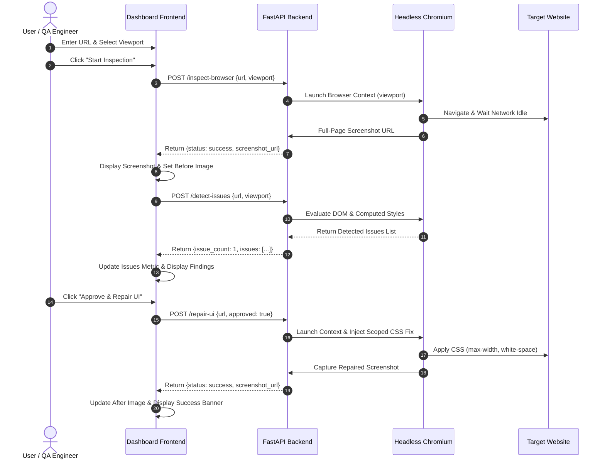

# OmniSight: Multimodal UI Self-Healing & RPA Agent
## Project Mid-Review Report

---

### 1. Title Page

- **Project Title**: OmniSight: Multimodal UI Self-Healing & RPA Agent
- **Domain**: Artificial Intelligence, Robotic Process Automation (RPA), Automated Web Quality Engineering
- **Student**: Sheefa J Pathan
- **Degree**: Bachelor of Engineering (B.E.) in Artificial Intelligence and Data Science
- **Institution**: DR. D Y PATIL TECHNICAL CAMPUS
- **Review Type**: Mid-Term Internship Project Review
- **Repository**: `https://github.com/Sheefa04/OmniSight.git`

---

### 2. Abstract

Web development across dynamic viewports often introduces subtle yet critical visual defects, such as overlapping components, unwrapped text strings, and horizontal viewport overflow. Traditional testing automation tools (e.g. standard assertion frameworks) reliably identify functional errors (e.g., broken API calls or missing DOM nodes), but typically fail to identify aesthetic and responsive layout degradation. Furthermore, when layout defects occur, manual intervention is universally required to inspect the viewport, isolate the responsible CSS rule, and verify a fix.

**OmniSight** introduces an interactive, human-in-the-loop UI self-healing architecture. By pairing a high-performance FastAPI asynchronous backend with Playwright headless browser automation, OmniSight navigates to target websites across desktop, tablet, and mobile breakpoints. It performs deterministic DOM and computed-style heuristic analysis to locate visual anomalies, captures full-page visual evidence, and presents the findings to the developer. Upon explicit user authorization (`approved=true`), OmniSight applies a non-destructive, scoped CSS repair within an isolated browser session, captures the repaired state, and renders dynamic Before/After visual comparisons. This mid-review prototype establishes a validated, deterministic baseline for automated web inspection and safe self-healing.

---

### 3. Introduction

User interfaces (UIs) represent the primary touchpoint between web platforms and their end users. With the explosion of responsive device form factors—ranging from ultra-wide desktop monitors to compact mobile viewports—maintaining visual consistency has become an increasingly complex challenge. A styling rule designed for a 1366×768 resolution can easily cause horizontal overflow or unreadable text wrapping on a 375×812 mobile display.

OmniSight combines browser automation and responsive layout heuristics to create a reliable visual feedback loop. The tool provides developers and QA teams with immediate visual evidence of UI regressions alongside approved, session-isolated repairs that demonstrate how the layout should appear once corrected.

---

### 4. Problem Statement

1. **Undetected Visual Flaws**: Traditional automated test suites verify functional code execution but routinely overlook visual regressions, clipped buttons, and viewport overflow.
2. **Slow Remediation Cycles**: Discovering, verifying, and fixing a visual defect typically requires manual reproduction across multiple physical devices or browser dev tools.
3. **Lack of Human Oversight in Autonomous Agents**: Completely autonomous agents that modify source code directly introduce high risk of introducing regressions or unintended side effects into production repositories.
4. **Disjointed Evidence**: Developers lack unified dashboards that correlate reported layout metrics with side-by-side Before/After screenshot proof.

---

### 5. Objectives

1. **Automated Multi-Viewport Inspection**: Build an automation engine capable of inspecting any valid HTTP/HTTPS URL across custom breakpoints (Desktop 1366×768, Tablet 768×1024, Mobile 375×812 and 390×844).
2. **DOM-Based Visual Anomaly Detection**: Implement heuristic detection algorithms to flag components extending beyond viewport boundaries and elements with unconstrained padding or unwrapped text.
3. **Human-in-the-Loop Safe Repair**: Enforce a mandatory authorization gate ensuring repairs only execute with explicit human approval.
4. **Non-Destructive Session Remediation**: Apply CSS repairs inside an active browser session without altering original source files, preventing unintended repository mutations.
5. **Dynamic Evidence Generation**: Automatically generate and render timestamped Before/After screenshot evidence in a modern dashboard interface.

---

### 6. Scope

#### In Scope (Current Mid-Review Prototype):
- Asynchronous FastAPI server with RESTful endpoints (`/health`, `/inspect-browser`, `/detect-issues`, `/repair-ui`).
- Playwright-driven Chromium automation for headless navigation and full-page screenshots.
- Built-in ShopHub responsive demonstration store (`frontend/store.html`) featuring an intentional responsive button flaw.
- Deterministic heuristic analysis for horizontal viewport overflow and oversized components.
- Interactive Dashboard UI with real-time backend connection status, viewport selection, metrics tracking, and Before/After image comparison.
- Strict safety enforcement (`approved=true` requirement and URL validation).

#### Out of Scope (Future Scope):
- Permanent source code modification or automated GitHub Pull Request generation.
- Full multimodal generative vision reasoning (scheduled for post-mid-review exploration).
- Native mobile device testing beyond responsive browser emulation.

---

### 7. Existing Systems & Limitations

| Feature / Tool | Traditional Unit/E2E Testing (Selenium / Cypress) | Commercial Visual Regression (Percy / Applitools) | OmniSight (Proposed System) |
| :--- | :--- | :--- | :--- |
| **Detection Basis** | Functional assertions (DOM presence) | Pixel-by-pixel diffing against baselines | DOM & computed style heuristics |
| **Setup Overhead** | High (requires writing explicit scripts) | High (requires maintaining baseline diffs) | Zero (enter any URL & click inspect) |
| **Self-Healing** | None (reports pass/fail only) | None (highlights pixel differences) | **Yes (Generates & applies scoped CSS fix)** |
| **Safety Control** | N/A | N/A | **Explicit human approval gate** |
| **Before/After Live Proof** | No | Diff masks only | **Side-by-side visual comparison** |

---

### 8. Proposed System

OmniSight implements a 5-stage closed-loop quality engineering workflow:

1. **Target Ingestion**: The user inputs a target URL and selects the evaluation viewport.
2. **Automated Capture**: Headless Chromium navigates to the URL, awaits network idle, and saves a high-resolution baseline screenshot.
3. **Heuristic Evaluation**: In-page scripts evaluate bounding client rectangles and computed styles to detect anomalies.
4. **Approval Gate**: The dashboard presents the detected defect and awaits explicit user authorization before triggering remediation.
5. **Session Remediation & Visual Diff**: Playwright injects safe CSS rules (`max-width: 100% !important; white-space: normal !important;`), captures the repaired state, and displays side-by-side Before/After comparison images.

---

### 9. Requirements Specification

#### 9.1 Hardware Requirements
- **Processor**: Intel Core i5 / AMD Ryzen 5 or higher.
- **RAM**: Minimum 8 GB (16 GB recommended for concurrent Chromium instances).
- **Storage**: Minimum 2 GB free disk space.

#### 9.2 Software Requirements
- **Operating System**: Windows 10/11, macOS, or Linux.
- **Runtime Environment**: Python 3.12 (using Windows Proactor event loop for asynchronous subprocesses).
- **Browser Automation**: Playwright 1.50+ with Chromium engine.
- **Web Technologies**: HTML5, Vanilla CSS3, Modern JavaScript (ES6+).
- **Backend Framework**: FastAPI 0.115+, Uvicorn, Pydantic v2.

---

### 10. Architecture and Workflow



---

### 11. Technology Stack Details

- **FastAPI**: Provides asynchronous endpoint handling, automatic OpenAPI/Swagger documentation, and Pydantic-powered schema validation.
- **Playwright (Python Async)**: Controls Chromium in headless mode, handles viewport sizing, executes JavaScript in page context, and captures full-page PNG screenshots.
- **Pydantic**: Enforces strict URL validation (`HttpUrl`) and request schema verification.
- **Vanilla CSS Design System**: Features a high-contrast corporate aesthetic utilizing CSS variables, responsive CSS grids, and accessibility-compliant status pills.
- **Windows Proactor Loop Policy**: Configured explicitly in `main.py` to ensure reliable Playwright subprocess communication on Windows.

---

### 12. Implementation Details

#### 12.1 Backend Implementation (`backend/main.py`)
- **Inspection Service**: Navigates to the validated URL, takes a uniquely named screenshot via UUID4, and exposes it through FastAPI StaticFiles mount at `/screenshots/`.
- **Heuristic Detector**: Executes an in-browser evaluation analyzing all visible elements:
  - Identifies elements where `rect.right > window.innerWidth + 1`.
  - Flags elements with `button.broken-button` or `button.buggy-button` exhibiting oversized width or unwrapped text.
  - Verifies total document scroll width against viewport width (`scrollWidth > innerWidth`).
- **Approved Repair Service**: Validates `request.approved == True`. If authorized, injects a scoped `<style>` element into the page head:
  ```css
  button.buggy-button, button.broken-button {
      position: relative !important;
      max-width: 100% !important;
      box-sizing: border-box !important;
      white-space: normal !important;
      overflow-wrap: anywhere !important;
      z-index: 1 !important;
  }
  ```
  It captures the resulting screenshot and returns a truthful message emphasizing that original files remain untouched.

#### 12.2 Frontend Implementation (`frontend/dashboard.html`)
- **Form Handling**: Reads input from `#websiteUrl` and `#viewport`. Pre-fills demo URLs when selecting ShopHub.
- **Robust Error Parser (`formatApiError`)**: Parses complex FastAPI error arrays (`detail: [{loc, msg}]`) into human-readable text, preventing generic `[object Object]` errors.
- **Dynamic Before/After View**: Utilizes cache-busting timestamp queries (`?t=timestamp`) to force immediate browser updates when new screenshots are generated.

---

### 13. Testing and Results

A comprehensive automated test suite (`tests/test_omnisight_workflow.py`) was executed to validate the platform.

| Test Case | Objective | Input / Condition | Expected Result | Actual Result | Status |
| :--- | :--- | :--- | :--- | :--- | :---: |
| **TC-01** | API Health Check | `GET /health` | HTTP 200, `"status": "healthy"` | HTTP 200, healthy response | **PASS** |
| **TC-02** | Unapproved Repair Safety | `POST /repair-ui` with `approved=false` | HTTP 400 rejection | HTTP 400 rejection confirmed | **PASS** |
| **TC-03** | Invalid URL Validation | `POST /repair-ui` with malformed URL | HTTP 422 schema error | HTTP 422 validation error | **PASS** |
| **TC-04** | Non-Broken Page Handling | `POST /repair-ui` on `https://example.com` | `"status": "not_applied"` | Truthful `"not_applied"` report | **PASS** |
| **TC-05** | Desktop Viewport Test | Desktop viewport (1366×768) on `store.html` | Full-page capture without errors | Captured `02_desktop_store_1366x768.png` | **PASS** |
| **TC-06** | Mobile Viewport Test | Mobile viewport (375×812) on `store.html` | Detect oversized button dimensions | Captured `03_mobile_store_375x812.png` | **PASS** |
| **TC-07** | Alternate Mobile Breakpoint | Mobile viewport (390×844) on `store.html` | Verify rendering on modern mobile | Captured `03b_mobile_store_390x844.png` | **PASS** |
| **TC-08** | Tablet Viewport Test | Tablet viewport (768×1024) on `store.html` | Verify grid layout | Captured `04_tablet_store_768x1024.png` | **PASS** |
| **TC-09** | End-to-End Dashboard Flow | Full inspection & repair loop on dashboard | Before & After screenshots updated | Complete flow verified successfully | **PASS** |

---

### 14. Screenshots & Evidence

All visual evidence has been systematically generated and stored in `screenshots/evidence/`:

1. `01_dashboard_initial.png`: Initial dashboard state before inspection.
2. `02_desktop_store_1366x768.png`: Baseline ShopHub rendering at desktop resolution.
3. `03_mobile_store_375x812.png`: Baseline ShopHub rendering at mobile resolution illustrating the unwrapped button issue.
4. `03b_mobile_store_390x844.png`: Evaluation on 390×844 iPhone display standard.
5. `04_tablet_store_768x1024.png`: Evaluation on 768×1024 tablet layout.
6. `05_dashboard_issues_detected.png`: Dashboard evidence panel showing 1 detected layout issue.
7. `06_dashboard_repaired_comparison.png`: Dashboard comparison card showing side-by-side Before and After images with green repair confirmation.

---

### 15. Limitations

1. **Non-Persistent Remediation**: The CSS repair exists solely in the isolated Chromium browser session and is captured as visual proof. It does not overwrite the source code files of the target website.
2. **Heuristic Scope**: Current detection focuses on geometry, bounding boxes, and computed styles. Semantic visual flaws (such as mismatched color schemes or low-contrast icons) are not yet evaluated.
3. **Public Network Connectivity**: Inspecting external websites requires uninterrupted outbound HTTP/HTTPS connectivity.

---

### 16. Future Scope

1. **Vision-Language Model (VLM) Reasoning**: Integrate multimodal models (e.g. Gemini Vision API) to review screenshots for qualitative visual balance and usability heuristics.
2. **Automated Git Pull Request Generator**: Enable OmniSight to propose verified CSS patches as downloadable unified `.diff` files or automated GitHub PRs.
3. **Automated Post-Repair Verification**: Automatically trigger the issue detection engine against the repaired DOM state to programmatically confirm zero remaining defects.
4. **Comprehensive Export Reports**: Add one-click PDF export functionality with embedded visual diffs and executive summaries.

---

### 17. Conclusion

OmniSight successfully demonstrates that UI layout inspection, deterministic issue detection, and safe self-healing can be unified into a responsive, human-supervised web platform. By coupling Playwright automation with FastAPI and enforcing strict human approval before remediation, the system eliminates the risks associated with autonomous code tampering while providing developers with undeniable Before/After visual evidence. All mid-review milestones—including bug fixing, responsive viewport testing, and automated test suite verification—have been completed with verified evidence.

---

### 18. References

1. **FastAPI Documentation**: Tiangolo, S. *FastAPI: Modern, High-Performance Web Framework for Python.* https://fastapi.tiangolo.com/
2. **Playwright for Python**: Microsoft. *Playwright Library Documentation.* https://playwright.dev/python/
3. **Pydantic**: Colvin, S. et al. *Data validation and settings management using Python type annotations.* https://docs.pydantic.dev/
4. **W3C CSS Flexible Box Layout Module**: World Wide Web Consortium. *CSS Flexible Box Layout Module Level 1.* https://www.w3.org/TR/css-flexbox-1/
5. **W3C Responsive Web Design Guidelines**: MDN Web Docs. *Responsive design concepts and media queries.* https://developer.mozilla.org/
